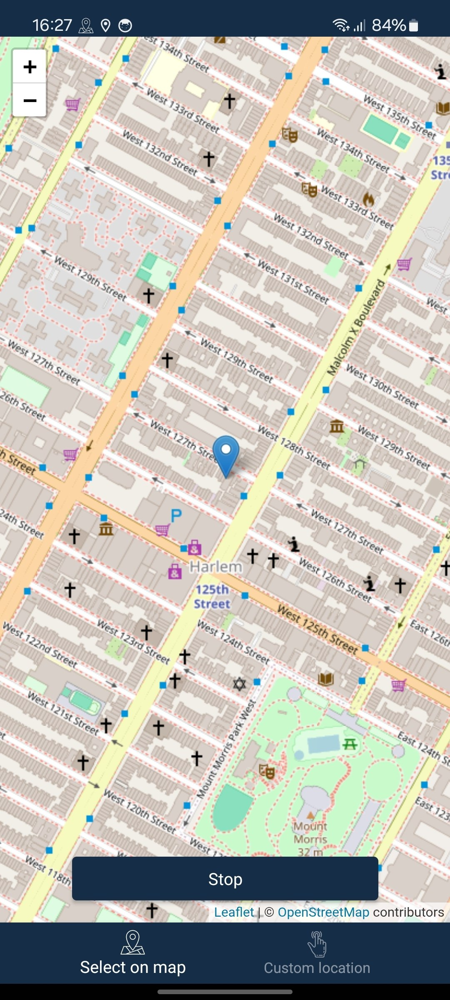
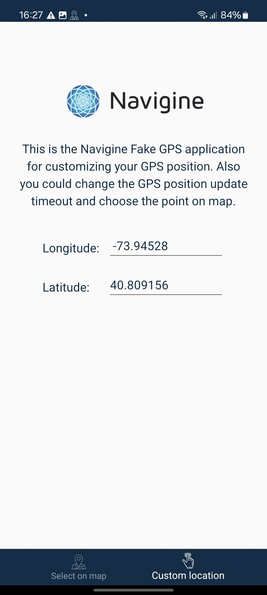

# Android-tricks

## Mock GPS

Demo application that replaces your smartphone's GPS and Network location with a point of your choice, using the standard Android Mock Location API.

  
  &nbsp;&nbsp;
  

Don't forget: choose this app as your Mock Location provider in Android Developer Settings.

### Features

- Pick a point on the map (long-press to place the marker)
- Or enter latitude and longitude manually
- Mocks both `GPS` and `NETWORK` providers once per second
- Keeps running in the background with a foreground notification

### Download

To run the APK on your device:
- Clone the repo and open it in Android Studio
- Minimal SDK version required: 21
- Or get it from [Releases](https://github.com/Navigine/Android-Fake-Mock-Location-Tricks/releases/latest)

### Useful Links
- [Navigine Official Website](https://navigine.com/) – Learn more about our technology, products, and services.
- [User Manual](http://docs.navigine.com/) – Full product usage guidelines and SDK documentation.
- [Get Started with Navigine](http://locations.navigine.com/login) – Create your account and begin building indoor navigation solutions.
- [Discuss the project](https://community.navigine.com/t/android-fake-mock-location-tricks/175) – Join the community thread for questions, feedback, and collaboration specific to this repository.
- [Contact Navigine](https://navigine.com/contacts/) – Reach out for business or technical support.

